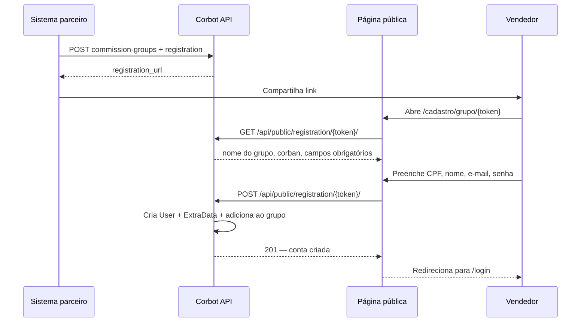

# Integração de sistema parceiro — Corbans, vendedores e grupos de comissionamento

> **Status:** implementado em `/api/integrations/v1/` e cadastro público em `/api/public/registration/{token}/` + `/cadastro/grupo/{token}`.

Documentação dedicada ao caso de uso: um **sistema externo** precisa criar Corbans, cadastrar vendedores, criar **acessos bancários** (login no banco vinculado ao perfil), configurar **grupos de comissionamento** vinculados a **tabelas** específicas e disponibilizar **links de cadastro** em que o vendedor já entra automaticamente no grupo correto.

---

## 1. Resumo executivo

| Necessidade | Situação atual | Recomendação |
|-------------|----------------|--------------|
| Criar Corban via API | **Parcial** — `POST /api/companies/` existe, mas exige Admin JWT e cria admin junto | Expor endpoint de integração com API Key e transação atômica |
| Criar vendedor via API | **Parcial** — `POST /api/users/sellers/` existe, mas permissões e validações não são ideais para terceiros | Endpoint dedicado que força `role=vendedor` e vincula ao Corban/grupo |
| Criar grupo de comissionamento | **Sim** — `POST /api/commission-groups/` com regras por banco/tabela | Reutilizar lógica; expor sob namespace de integração |
| Criar acesso bancário | **Parcial** — `POST /api/bank-accesses/` existe (JWT Admin/Gerente); escopos `bank_access:read/write` na API Key | Endpoint de integração com API Key, isolamento por Corban e validação de login CPF/e-mail |
| Link de cadastro por grupo | **Não existe** | Novo modelo + página pública + endpoints |
| Acesso a tabela específica | **Parcial** — tabelas são referenciadas por UUID nas regras; leitura via `GET /api/tables/` | Documentar IDs; opcionalmente restringir tabelas por integração |
| Consultar saldo / comissões / recebimentos | **Parcial** — endpoints JWT existem (`/commissions/`, `/balance/`, `/mirror/`, saques) | Expor sob `/api/integrations/v1/` com escopos e isolamento por Corban |

**Conclusão:** a base de dados e a maior parte da lógica de negócio **já suportam** o fluxo. O que falta é uma **camada de integração** (autenticação segura, endpoints estáveis, links de cadastro e enforcement de escopos).

---

## 2. Conceitos no Corbot

### 2.1 Corban (`Company`)

Representa o parceiro/correspondente bancário. Campos principais:

| Campo | Tipo | Obrigatório | Observação |
|-------|------|-------------|------------|
| `name` | string | sim | Razão social ou nome |
| `person_type` | `PF` \| `PJ` | sim | Define tamanho do documento |
| `document` | string | sim | CPF (11 dígitos) ou CNPJ (14), sem pontuação |
| `email` | string | não | Usado no admin se não informado outro |
| `trading_name`, `phone`, endereço, cores | vários | não | Opcionais |

Ao criar um Corban pelo fluxo interno, o sistema também cria um usuário **`empresa_admin`** cujo login é o **documento da empresa**.

### 2.2 Vendedor (`User` com `role=vendedor`)

Não há modelo separado. O vendedor é um `User` com:

| Campo | Obrigatório | Observação |
|-------|-------------|------------|
| `cpf` | sim | 11 dígitos, único por papel/empresa |
| `email` | sim | |
| `first_name`, `last_name` | recomendado | |
| `password` | sim* | *No fluxo proposto, senha definida pelo próprio vendedor no link |
| `company` | sim | UUID do Corban |
| `leader` | não | ID do líder (mesma empresa) |
| `matricula`, `certificado` | não | |
| `extra_data` | não | `phone`, `pix_key`, `pix_type`, `birth_date`, etc. |

### 2.3 Grupo de comissionamento (`CommissionGroup`)

Agrupa vendedores/líderes e define **taxas por banco + tabela**:

| Campo | Descrição |
|-------|-----------|
| `name`, `description`, `color` | Identificação visual |
| `company` | UUID do Corban (ou `null` = grupo da promotora) |
| `commission_rules` | Lista de regras (`bank`, `table`, `commission_range`, `leader_commission_rate`, `seller_commission_rate`) |
| `sellers`, `leaders` | Usuários membros (M2M) |

**Tabela específica:** cada regra referencia `bank` (UUID) e `table` (UUID). As taxas do grupo **não podem exceder** o teto do `CommissionGroupByCompany` ao qual o Corban pertence (quando configurado pela promotora).

### 2.4 Grupo promotora × Corban (`CommissionGroupByCompany`)

Antes de criar grupos para um Corban, a promotora normalmente o associa a um **grupo de Corbans** que define as taxas máximas por tabela. Sem isso, a validação de tetos pode não aplicar limites.

### 2.5 Acesso bancário (`BankAccess`)

Credencial de login no sistema do **banco parceiro**, vinculada a um **usuário** do Corbot (vendedor, líder, gerente ou `empresa_admin`).

É o que permite associar propostas/produção ao perfil correto e definir se a comissão segue a regra **master** (Corban) ou os **grupos de comissionamento** da equipe.

| Campo | Tipo | Obrigatório | Observação |
|-------|------|-------------|------------|
| `bank` | UUID | sim | Banco (`Bank.id`) |
| `user` | int | sim* | ID do usuário dono do acesso (*obrigatório na prática de integração) |
| `username` | string | sim | Login no banco (e-mail **ou** CPF, conforme o banco) |
| `password` | string | sim | Senha do portal do banco (write-only na API) |
| `is_master` | bool | não | `true` = master Corban (comissão direta pela promotora); `false` = equipe/grupos |
| `is_active` | bool | não | Default `true` |
| `notes`, `link` | string | não | Observação e URL auxiliar |
| `alias` | JSON list | não | Vínculos adicionais |
| `created_by` | int | não | Preenchido automaticamente pelo autenticado |

**Regras de negócio:**

| Regra | Detalhe |
|-------|---------|
| Tipo de login do banco | `Bank.access_login_type`: `cpf` ou `email` |
| Banco com login CPF | `username` **deve** ser o CPF do usuário; **no máximo 1** acesso por `(user, bank)` |
| Banco com login e-mail | Vários acessos por `(user, bank)` desde que `username` seja único no banco |
| Unicidade | `(bank, username)` é único no sistema |
| Master | `is_master=true` só com `role=empresa_admin`; Corban **exige** acesso master |
| Equipe | `is_master=false` para `vendedor` / `lider` / `gerente` |

**Impacto na comissão:** acesso **master** → comissão direta (promotora → Corban). Acesso **não master** → comissão pelos grupos da equipe/vendedor.

### 2.6 Comissão, excedente e papéis

Cada proposta paga gera **uma ou mais linhas de comissão**, cada uma com um `role`:

| `role` | Quem recebe | Origem da taxa |
|--------|-------------|----------------|
| `vendedor` | O vendedor que produziu a proposta | `seller_commission_rate` do grupo |
| `lider` | O líder do vendedor | `leader_commission_rate` do grupo |
| `empresa` | O Corban (`empresa_admin`) | **Excedente** = teto − (vendedor + líder) |

**Exemplo (regra do Corban):**

- Teto da tabela / limite da promotora: **50%**
- Grupo define pagar **40%** ao vendedor e **0%** ao líder
- Comissão `empresa` (excedente do Corban): **10%**

O `empresa_admin` **vê todas as comissões do Corban** (vendedor, líder e empresa).  
O **vendedor** vê **somente** as comissões em que ele é o recebedor (`user` = ele, tipicamente `role=vendedor`).

Status de liberação (`release_status`):

| Status | Significado |
|--------|-------------|
| `not_released` | Gerada, ainda não liberada para pagamento |
| `withdraw_available` | Liberada para saque (entra no saldo disponível) |
| `pending_manual_payment` | Aguardando pagamento manual |
| `paid` | Já paga / baixada |

Formas de recebimento:

| Forma | Como aparece | Observação |
|-------|--------------|------------|
| Saque CorbanPay | `payment_method=withdraw` + link de saque | Fluxo `/withdrawals/corbanpay/` |
| Pagamento manual | `payment_method=manual` | Baixa operacional pela promotora/corban |
| Ainda não pago | `payment` nulo ou status pendente | Ver `release_status` |

---

## 3. Autenticação para integração

### 3.1 Opções hoje

| Método | Header | Uso |
|--------|--------|-----|
| JWT | `Authorization: Bearer <token>` | Login de usuário humano (Admin, etc.) |
| API Key | `Authorization: Api-Key crb_...` | Integrações de terceiros |

API Keys são gerenciadas em `GET/POST /api/api-keys/` (somente Admin da promotora).

**Escopos disponíveis** (relevantes para este caso):

- `companies:read` / `companies:write`
- `users:read` / `users:write`
- `tables:read`
- `bank_access:read` / `bank_access:write`
- `commissions:read` / `commissions:write`

### 3.2 Limitações atuais (importante)

1. **Escopos não são aplicados nas views** — a chave autentica como o usuário que a criou (geralmente Admin), com privilégios amplos.
2. O campo `company` na API Key **não restringe** automaticamente o que pode ser criado.
3. Não há namespace `/api/integrations/` — tudo usa `/api/`.

**Antes de produção com parceiro externo**, implementar:

- Permission class `HasAPIKeyScope('companies:write')` etc.
- Isolamento: chave vinculada a um Corban só opera nesse Corban (quando aplicável).
- Auditoria com `request.api_key.id` e `Idempotency-Key`.

---

## 4. API atual (reutilizável hoje)

Base URL: `https://<seu-dominio>/api`

### 4.1 Criar Corban

```http
POST /api/companies/
Authorization: Bearer <jwt_admin>
Content-Type: application/json
```

```json
{
  "company": {
    "name": "Corban Parceiro LTDA",
    "person_type": "PJ",
    "document": "12345678000190",
    "email": "contato@parceiro.com.br"
  },
  "admin_user": {
    "password": "SenhaInicialSegura123",
    "email": "admin@parceiro.com.br",
    "matricula": "001"
  }
}
```

**Resposta `201`:**

```json
{
  "company": { "id": "uuid-do-corban", "name": "...", "document": "..." },
  "admin_user": { "id": 42, "role": "empresa_admin", "company": "uuid-do-corban" }
}
```

**Regras:**

- Somente **Admin da promotora**.
- Login do admin = **CNPJ/CPF da empresa** (sem máscara).
- Se falhar ao criar o admin após criar a empresa, pode haver Corban órfão (não transacional hoje).

### 4.2 Criar vendedor

```http
POST /api/users/sellers/
Authorization: Bearer <jwt>
Content-Type: application/json
```

```json
{
  "cpf": "12345678901",
  "email": "vendedor@exemplo.com",
  "first_name": "João",
  "last_name": "Silva",
  "password": "SenhaInicial123",
  "role": "vendedor",
  "company": "uuid-do-corban",
  "leader": 10,
  "matricula": "V-100",
  "extra_data": {
    "phone": "11999998888",
    "pix_key": "12345678901",
    "pix_type": "CPF"
  }
}
```

**Permissões:** Admin, Gerente ou Líder.

**Atenção:** o payload aceita `role` e `company` livremente — inadequado para API pública sem hardening.

### 4.3 Vincular vendedor a grupo existente

```http
PUT /api/commission-groups/{id}/members/
Authorization: Bearer <jwt>
Content-Type: application/json
```

```json
{
  "user_ids": [101, 102, 103]
}
```

Substitui a lista de membros. IDs com `role=vendedor` vão para `sellers`; líderes para `leaders`. Ao incluir um líder, seus vendedores podem ser adicionados automaticamente.

### 4.4 Criar grupo de comissionamento (com tabelas)

```http
POST /api/commission-groups/
Authorization: Bearer <jwt>
Content-Type: application/json
```

```json
{
  "name": "Equipe Digital — Tabela X",
  "description": "Grupo criado pela integração",
  "company": "uuid-do-corban",
  "color": "#2563eb",
  "is_active": true,
  "by_leader": false,
  "commission_rules": [
    {
      "bank": "uuid-do-banco",
      "table": "uuid-da-tabela",
      "commission_range": 1,
      "leader_commission_rate": "0.50",
      "seller_commission_rate": "1.50"
    }
  ]
}
```

**Permissões:** Admin, `empresa_admin`, Gerente ou Líder.

**Consultar taxas máximas** (tetos do Corban):

```http
GET /api/commission-groups/max-rates/
```

**Listar tabelas** (para obter UUIDs):

```http
GET /api/tables/
GET /api/tables/by-bank/{bank_uuid}/
```

### 4.5 Criar acesso bancário

```http
POST /api/bank-accesses/
Authorization: Bearer <jwt>
Content-Type: application/json
```

```json
{
  "bank": "uuid-do-banco",
  "user": 101,
  "username": "vendedor@exemplo.com",
  "password": "SenhaDoPortalDoBanco",
  "is_master": false,
  "is_active": true,
  "notes": "Acesso criado pela operação",
  "link": null
}
```

**Exemplo — acesso master do Corban (login por CPF):**

```json
{
  "bank": "uuid-do-banco",
  "user": 42,
  "username": "12345678000190",
  "password": "SenhaDoPortalDoBanco",
  "is_master": true,
  "is_active": true
}
```

> Em bancos com `access_login_type=cpf`, o `username` deve ser o CPF do usuário vinculado (para `empresa_admin`, tipicamente o documento da empresa / login do Corban).

**Resposta `201`:** retorna o `BankAccess` criado (`id`, `bank`, `bank_name`, `bank_access_login_type`, `username`, `is_master`, `user`, etc.). A senha **não** é devolvida (`write_only`).

**Permissões:** Admin ou Gerente (`POST`/`PUT`/`PATCH`/`DELETE`). Listagem/leitura: autenticado, filtrado pela hierarquia.

**Listar / detalhar:**

```http
GET /api/bank-accesses/
GET /api/bank-accesses/{uuid}/
Authorization: Bearer <jwt>
```

**Atualizar / excluir:**

```http
PUT|PATCH /api/bank-accesses/{uuid}/
DELETE /api/bank-accesses/{uuid}/
Authorization: Bearer <jwt>
```

**Importação em lote (painel):** a entidade `bank_access` no job de importação aceita linhas com `cpf`, `bank_name`, `username`, `password`, `is_master`, `is_active`, `notes`, `link` — útil operacionalmente, mas **não** é o contrato estável para integração parceira.

---

## 5. API proposta — namespace de integração

Endpoints estáveis para o parceiro, independentes da UI interna.

Prefixo sugerido: `/api/integrations/v1/`

Autenticação: `Authorization: Api-Key crb_...`

### 5.1 Criar Corban

```http
POST /api/integrations/v1/corbans/
Authorization: Api-Key crb_...
Idempotency-Key: parceiro-corban-12345
Content-Type: application/json
```

```json
{
  "external_id": "ERP-9876",
  "company": {
    "name": "Corban Parceiro LTDA",
    "person_type": "PJ",
    "document": "12345678000190",
    "email": "contato@parceiro.com.br"
  },
  "admin_user": {
    "email": "admin@parceiro.com.br",
    "send_invite": true
  },
  "commission_group_by_company_id": 3
}
```

| Campo | Descrição |
|-------|-----------|
| `external_id` | ID no sistema parceiro (idempotência) |
| `send_invite` | Envia e-mail com link para definir senha (em vez de senha no payload) |
| `commission_group_by_company_id` | Opcional: associa o Corban ao grupo promotora com tetos de tabela |

**Resposta `201`:**

```json
{
  "company_id": "uuid",
  "admin_user_id": 42,
  "external_id": "ERP-9876",
  "login_document": "12345678000190"
}
```

### 5.2 Criar vendedor (sistema parceiro)

```http
POST /api/integrations/v1/sellers/
Authorization: Api-Key crb_...
Idempotency-Key: parceiro-seller-555
```

```json
{
  "external_id": "ERP-V-555",
  "cpf": "12345678901",
  "email": "joao@exemplo.com",
  "first_name": "João",
  "last_name": "Silva",
  "company_id": "uuid-do-corban",
  "leader_id": 10,
  "commission_group_id": 15,
  "matricula": "V-100",
  "extra_data": {
    "phone": "11999998888"
  }
}
```

| Comportamento | Detalhe |
|---------------|---------|
| `role` | Sempre `vendedor` (ignorado se enviado) |
| `company_id` | Validado contra escopo da API Key |
| `commission_group_id` | Vendedor adicionado ao grupo na mesma transação |
| `password` | Opcional; se omitido, conta inativa até ativação |

### 5.3 Criar grupo + link de cadastro

```http
POST /api/integrations/v1/commission-groups/
Authorization: Api-Key crb_...
```

```json
{
  "name": "Captação App Parceiro",
  "company_id": "uuid-do-corban",
  "description": "Vendedores cadastrados pelo app externo",
  "color": "#16a34a",
  "commission_rules": [
    {
      "bank": "uuid-banco",
      "table": "uuid-tabela-especifica",
      "commission_range": 1,
      "leader_commission_rate": "0.00",
      "seller_commission_rate": "2.00"
    }
  ],
  "registration": {
    "expires_at": "2026-12-31T23:59:59-03:00",
    "max_uses": 500,
    "allowed_role": "vendedor"
  }
}
```

**Resposta `201`:**

```json
{
  "id": 15,
  "name": "Captação App Parceiro",
  "registration": {
    "id": "uuid-do-link",
    "url": "https://app.seudominio.com/cadastro/grupo/rgl_abc123...",
    "expires_at": "2026-12-31T23:59:59-03:00",
    "max_uses": 500,
    "uses_count": 0
  }
}
```

### 5.4 Gerar novo link para grupo existente

```http
POST /api/integrations/v1/commission-groups/{id}/registration-links/
```

```json
{
  "expires_at": "2026-08-01T00:00:00-03:00",
  "max_uses": 100
}
```

### 5.5 Revogar link

```http
POST /api/integrations/v1/registration-links/{id}/revoke/
```

### 5.6 Criar acesso bancário

Escopo: `bank_access:write` (criação/atualização) e `bank_access:read` (consulta).

```http
POST /api/integrations/v1/bank-accesses/
Authorization: Api-Key crb_...
Idempotency-Key: parceiro-acesso-banco-001
Content-Type: application/json
```

```json
{
  "external_id": "ERP-BA-001",
  "bank_id": "uuid-do-banco",
  "user_id": 101,
  "username": "vendedor@exemplo.com",
  "password": "SenhaDoPortalDoBanco",
  "is_master": false,
  "is_active": true,
  "notes": "Acesso sincronizado pelo ERP",
  "link": null
}
```

**Alternativa por documento** (quando o parceiro não guarda o `user_id` interno):

```json
{
  "external_id": "ERP-BA-CORBAN-MASTER",
  "bank_id": "uuid-do-banco",
  "cpf": "12345678901",
  "username": "12345678901",
  "password": "SenhaDoPortalDoBanco",
  "is_master": true,
  "is_active": true
}
```

| Campo | Descrição |
|-------|-----------|
| `external_id` | ID no sistema parceiro (idempotência) |
| `bank_id` | UUID do banco (`Bank.id`) |
| `user_id` **ou** `cpf` | Identifica o usuário dono; `cpf` resolve perfil conforme `is_master` |
| `username` / `password` | Credenciais do portal do banco |
| `is_master` | `true` → perfil Corban (`empresa_admin`); `false` → equipe |

| Comportamento | Detalhe |
|---------------|---------|
| Escopo da chave | Usuário deve pertencer ao Corban da API Key (quando a chave tem `company`) |
| Login CPF | Valida `username` = CPF do usuário; rejeita segundo acesso no mesmo banco |
| Login e-mail | Permite vários `username` distintos no mesmo `(user, bank)` |
| Upsert | Se `(bank, username)` já existir no escopo autorizado, atualiza senha/vínculo (ou retorna `409` se política for create-only) |
| Senha | Nunca retornada na resposta |

**Resposta `201`:**

```json
{
  "id": "uuid-do-acesso",
  "external_id": "ERP-BA-001",
  "bank_id": "uuid-do-banco",
  "bank_name": "Banco Exemplo",
  "bank_access_login_type": "email",
  "user_id": 101,
  "username": "vendedor@exemplo.com",
  "is_master": false,
  "is_active": true
}
```

**Consultar:**

```http
GET /api/integrations/v1/bank-accesses/?user_id=101
GET /api/integrations/v1/bank-accesses/?cpf=12345678901
GET /api/integrations/v1/bank-accesses/{uuid}/
Authorization: Api-Key crb_...
```

Escopo: `bank_access:read`.

---

## 6. Cadastro público via link (a implementar)

### 6.1 Fluxo do vendedor



### 6.2 Endpoints públicos propostos

| Método | Path | Descrição |
|--------|------|-----------|
| `GET` | `/api/public/registration/{token}/` | Valida token; retorna metadados do grupo (sem dados sensíveis) |
| `POST` | `/api/public/registration/{token}/` | Cria vendedor e associa ao grupo |

**Payload de cadastro:**

```json
{
  "cpf": "12345678901",
  "email": "joao@exemplo.com",
  "first_name": "João",
  "last_name": "Silva",
  "password": "SenhaForte123!",
  "extra_data": {
    "phone": "11999998888",
    "pix_key": "12345678901",
    "pix_type": "CPF"
  }
}
```

### 6.3 Regras de segurança do link

| Regra | Motivo |
|-------|--------|
| Token com prefixo `rgl_`, armazenado apenas como **hash** | Evitar vazamento no banco |
| `company` e `commission_group` derivados do token, **nunca** do body público | Impedir cadastro em grupo errado |
| `allowed_role` fixo em `vendedor` | Não permitir elevação de privilégio |
| `expires_at`, `max_uses`, revogação | Controle operacional |
| Rate limit por IP + por token | Anti-abuso |
| CPF único na empresa | Mesma regra do cadastro interno |

### 6.4 Modelo sugerido: `CommissionGroupRegistrationLink`

| Campo | Tipo |
|-------|------|
| `id` | UUID |
| `commission_group` | FK → `CommissionGroup` |
| `company` | FK → `Company` (redundante para validação rápida) |
| `token_prefix` | string (ex.: primeiros 8 chars) |
| `token_hash` | SHA-256 |
| `created_by` | FK User ou API Key |
| `expires_at` | datetime, nullable |
| `max_uses` | int, nullable |
| `uses_count` | int, default 0 |
| `allowed_role` | default `vendedor` |
| `is_active` | bool |

---

## 7. Fluxo completo recomendado para o parceiro

### Cenário A — Parceiro cria tudo via API

1. Promotora cria **API Key** com escopos `companies:write`, `users:write`, `bank_access:write`, `commissions:write`, `tables:read`.
2. Promotora associa o Corban ao **CommissionGroupByCompany** com as tabelas permitidas (painel interno).
3. Parceiro: `POST /integrations/v1/corbans/` → recebe `company_id` e `admin_user_id`.
4. Parceiro: `POST /integrations/v1/bank-accesses/` com `is_master=true` e `user_id` do admin → acesso master do Corban no(s) banco(s).
5. Parceiro: `POST /integrations/v1/commission-groups/` com `table` = UUID da tabela específica → recebe `registration.url`.
6. Parceiro distribui o link aos vendedores **ou** usa `POST /integrations/v1/sellers/` para cadastro direto.
7. Para cada vendedor: `POST /integrations/v1/bank-accesses/` com `is_master=false` e o login do portal do banco.

### Cenário B — Link de cadastro (self-service)

1. Passos 1–5 iguais.
2. Vendedor acessa o link → preenche formulário → entra automaticamente no grupo com as taxas da tabela configurada.
3. Parceiro (ou operação) cria o acesso bancário do vendedor: `POST /integrations/v1/bank-accesses/` com `user_id`/`cpf` e credenciais do banco.
4. Parceiro consulta membros: `GET /api/commission-groups/{id}/` (leitura).

### Cenário C — Vendedor já existe no parceiro

1. `POST /integrations/v1/sellers/` com `commission_group_id`.
2. Sistema valida CPF, cria usuário e adiciona ao grupo em uma transação.
3. `POST /integrations/v1/bank-accesses/` vinculando o login do banco ao vendedor criado.

---

## 8. Tabela específica — como referenciar

O parceiro precisa do **UUID da tabela** (`Table.id`) e do **UUID do banco** (`Bank.id`).

**Obter tabelas (leitura):**

```http
GET /api/tables/?search=nome+da+tabela
Authorization: Api-Key crb_...
```

**Exemplo de item:**

```json
{
  "id": "a1b2c3d4-e5f6-7890-abcd-ef1234567890",
  "name_in_bank": "INSS NOVO GOLD",
  "bank": "uuid-do-banco",
  "commission_rate": "3.50",
  "is_active": true
}
```

Na criação do grupo, use esse `id` em `commission_rules[].table`.

**Validação:** a soma `leader_commission_rate + seller_commission_rate` por banco/tabela não pode ultrapassar o teto do `CommissionGroupByCompany` do Corban.

---

## 9. Consulta e gerenciamento de comissões (parceiro)

Objetivo do sistema parceiro: o usuário autenticado (ou a API Key atuando em nome de um Corban) precisa:

1. **Ver saldo** disponível e pendente  
2. **Ver status** das comissões  
3. Saber **quanto recebeu**, de **quais propostas**  
4. Saber **como** foi recebido (saque, manual, etc.)

### 9.1 Visibilidade por papel

| Papel | O que vê | Saldo |
|-------|----------|-------|
| `vendedor` | Só comissões em que `user` = ele | Só o próprio saldo |
| `lider` | Próprias + da equipe (vendedores subordinados) | Próprio saldo |
| `empresa_admin` | **Todas** as comissões do Corban (`company` = seu Corban), inclusive `role=empresa` (excedente) | Saldo das comissões atribuídas a ele (tipicamente o excedente) |
| `gerente` | Comissões dos usuários do Corban | Conforme regras internas |

**Regra de produto (excedente):**  
Se o teto/repasse for 50% e o grupo pagar 40% ao vendedor, o Corban (`empresa_admin`) fica com 10% em comissões `role=empresa`. O vendedor **não** vê essa fatia.

### 9.2 Endpoints existentes hoje (JWT)

Úteis como referência de contrato; na integração preferir o namespace proposto em §9.4.

#### Saldo

```http
GET /api/commissions/balance/
Authorization: Bearer <jwt>
```

**Resposta:**

```json
{
  "available": 1250.40,
  "pending": 300.00
}
```

| Campo | Significado |
|-------|-------------|
| `available` | Soma de comissões com `release_status=withdraw_available` do usuário |
| `pending` | Soma com `release_status=pending_manual_payment` |

#### Listar comissões (status + valor + proposta)

```http
GET /api/commissions/?begin_date=2026-01-01&end_date=2026-07-27&release_status=withdraw_available
Authorization: Bearer <jwt>
```

Query params úteis: `begin_date`, `end_date`, `client_document`, `client_name`, `user`, `company`, `role`, `proposal_id`, `payment_id`, `status` (status do `Payment` vinculado).

**Item típico:**

```json
{
  "id": 901,
  "proposal": "uuid-da-proposta",
  "user": 42,
  "user_details": { "id": 42, "first_name": "João", "role": "vendedor" },
  "company": "uuid-do-corban",
  "role": "vendedor",
  "role_display": "Vendedor",
  "percentage": "40.00",
  "value": "800.00",
  "payment": 55,
  "release_status": "withdraw_available",
  "released": true,
  "released_at": "2026-07-20T14:00:00-03:00",
  "paid_at": null,
  "created_at": "2026-07-15T10:00:00-03:00"
}
```

Filtros de escopo já aplicados no backend conforme o papel do JWT (vendedor não lista comissões de outros).

#### Espelho por proposta (quanto + de quem + quais propostas)

```http
GET /api/commissions/mirror/?begin_date=2026-01-01&end_date=2026-07-27
Authorization: Bearer <jwt>
```

Agrupa por proposta: mostra cliente, valor da operação e as fatias `vendedor` / `lider` / `empresa`.  
É o endpoint recomendado para a tela “recebimentos por proposta”.

#### Como foi recebido (pagamentos e saques)

```http
GET /api/withdrawals/
Authorization: Bearer <jwt>
```

Histórico de saques do usuário / Corban (conforme papel).

```http
GET /api/withdrawals/corbanpay/
Authorization: Bearer <jwt>
```

Consulta transações CorbanPay (link de saque, status, valor).

```http
POST /api/withdrawals/corbanpay/
Authorization: Bearer <jwt>
```

Inicia saque das comissões `withdraw_available` do usuário → retorna `withdrawal_link` e marca fluxo de recebimento via CorbanPay.

Para pagamento manual, o vínculo aparece em `commission.payment` + `payment_method` / `payment_details` / `paid_at`.

### 9.3 Fluxo sugerido na UI do parceiro

```text
[ Login / contexto do usuário ]
        │
        ├─► Saldo
        │     GET .../balance/
        │     → available / pending
        │
        ├─► Minhas comissões (vendedor)
        │     GET .../commissions/?release_status=...
        │     → lista valor, %, status, proposal_id
        │
        ├─► Visão Corban (empresa_admin)
        │     GET .../commissions/  (todas do company)
        │     GET .../commissions/mirror/
        │     → fatia vendedor + líder + excedente empresa
        │
        └─► Recebimentos
              GET .../withdrawals/ + .../corbanpay/
              → método (saque/manual), data, valor, propostas vinculadas
```

### 9.4 API proposta sob integração

Prefixo: `/api/integrations/v1/`  
Auth: `Authorization: Api-Key crb_...`  
Escopos: `commissions:read` (consulta) e, se houver saque via API, `payments:write`.

Quando a chave estiver vinculada a um Corban (`APIKey.company`), **todo** filtro de company é forçado para esse Corban.  
Para consultar “como vendedor”, a API Key (ou um token de usuário) deve identificar o `user_id` / CPF do vendedor.

| Método | Path | Descrição |
|--------|------|-----------|
| `GET` | `/api/integrations/v1/commissions/balance/?user_id=` | Saldo do usuário (ou do `empresa_admin` do Corban da chave) |
| `GET` | `/api/integrations/v1/commissions/` | Lista comissões com filtros de status/período/proposta |
| `GET` | `/api/integrations/v1/commissions/mirror/` | Espelho por proposta (valor + fatias + cliente) |
| `GET` | `/api/integrations/v1/commissions/{id}/` | Detalhe de uma comissão |
| `GET` | `/api/integrations/v1/withdrawals/` | Histórico de recebimentos/saques |
| `POST` | `/api/integrations/v1/withdrawals/corbanpay/` | (Opcional) disparar saque CorbanPay |

**Query params recomendados em listagens:**

| Param | Uso |
|-------|-----|
| `begin_date` / `end_date` | Período |
| `release_status` | `not_released` \| `withdraw_available` \| `pending_manual_payment` \| `paid` |
| `role` | `vendedor` \| `lider` \| `empresa` |
| `user_id` / `cpf` | Filtrar recebedor (admin do Corban) |
| `proposal_id` | Comissões de uma proposta |
| `client_document` | Busca por CPF/CNPJ do cliente |

**Resposta sugerida de saldo (integração):**

```json
{
  "user_id": 42,
  "company_id": "uuid-do-corban",
  "available": 1250.40,
  "pending": 300.00,
  "paid_in_period": 4200.00,
  "currency": "BRL"
}
```

**Resposta sugerida de item no espelho:**

```json
{
  "proposal_id": "uuid",
  "client_name": "Maria Silva",
  "client_document": "12345678901",
  "proposal_value": "10000.00",
  "bank_name": "Banco X",
  "table_name": "INSS GOLD",
  "seller": {
    "user_id": 42,
    "name": "João Silva",
    "percentage": "40.00",
    "value": "4000.00",
    "release_status": "paid"
  },
  "leader": null,
  "company": {
    "company_id": "uuid-do-corban",
    "percentage": "10.00",
    "value": "1000.00",
    "release_status": "withdraw_available",
    "note": "Excedente do Corban (teto 50% − 40% vendedor)"
  },
  "payment": {
    "id": 55,
    "method": "withdraw",
    "status": "paid",
    "paid_at": "2026-07-21T16:00:00-03:00",
    "channel": "corbanpay",
    "withdrawal_link": null
  }
}
```

### 9.5 Regras de autorização na integração

1. Chave **sem** `company`: só Admin da promotora (ou escopo amplo) — evitar em produção parceira.  
2. Chave **com** `company`: só dados daquele Corban.  
3. Consulta “como vendedor”: obrigatório `user_id`/`cpf` pertencente ao Corban da chave; nunca retornar `role=empresa` de outros nem comissões alheias.  
4. Consulta “como empresa_admin”: pode listar todos os `role` do Corban e filtrar `role=empresa` para o excedente.  
5. Saque via API: somente sobre comissões `withdraw_available` do próprio recebedor.

### 9.6 Checklist de implementação no sistema parceiro

- [ ] Tela de saldo (`available` / `pending`)
- [ ] Lista de comissões com badge de `release_status`
- [ ] Detalhe/espelho: proposta → fatias vendedor / líder / empresa
- [ ] Para `empresa_admin`: visão consolidada do Corban + destaque do excedente
- [ ] Para `vendedor`: filtro rígido “só minhas”
- [ ] Histórico de recebimento: método (`withdraw` / `manual`), data, valor, propostas
- [ ] (Opcional) botão “Sacar” chamando CorbanPay e abrindo `withdrawal_link`

---

## 10. Matriz de implementação

| Item | Esforço | Prioridade |
|------|---------|------------|
| Enforcement de escopos da API Key | Médio | **P0** — bloqueador de segurança |
| `POST /integrations/v1/corbans/` transacional | Médio | P1 |
| `POST /integrations/v1/sellers/` hardened | Médio | P1 |
| Reuso de `POST /commission-groups/` sob integração | Baixo | P1 |
| Modelo + API de registration link | Médio | P1 |
| Página frontend `/cadastro/grupo/[token]` | Médio | P1 |
| `POST /integrations/v1/bank-accesses/` (criar/listar acessos) | Médio | P1 |
| Consulta de comissões/saldo/espelho sob integração | Médio | P1 |
| `external_id` + idempotência | Baixo | P2 |
| Convite por e-mail (admin/vendedor) | Médio | P2 |
| Webhook de confirmação (`seller.created`) | Baixo | P3 |
| Saque CorbanPay via integração | Médio | P3 |

---

## 11. Erros comuns

| HTTP | Causa |
|------|-------|
| `400` | Documento/CPF inválido ou duplicado |
| `400` | Taxas do grupo excedem teto da promotora para aquela tabela |
| `400` | Acesso: `username` ≠ CPF do usuário (banco com login CPF) |
| `400` | Acesso: segundo acesso no mesmo banco (login CPF) ou master/equipe inconsistente com o `role` |
| `403` | API Key sem escopo ou tentativa de criar em Corban não autorizado |
| `403` | Vendedor tentando ver comissão/saldo de outro usuário |
| `404` | `table`, `bank` ou usuário do acesso inexistente |
| `409` | `Idempotency-Key`, `external_id` já processado, ou `(bank, username)` duplicado |
| `410` | Link de cadastro expirado ou revogado |
| `422` | Link atingiu `max_uses` |

---

## 12. Checklist de go-live

- [ ] API Key dedicada ao parceiro (não reutilizar chave de Admin pessoal)
- [ ] Escopos mínimos necessários configurados **e** enforced no código (incl. `bank_access:write` se criar acessos)
- [ ] Corban associado ao `CommissionGroupByCompany` correto (tabelas e tetos)
- [ ] UUIDs de banco/tabela documentados para o parceiro
- [ ] Teste: criar Corban → criar acesso master → criar grupo com tabela → cadastro via link → vendedor aparece no grupo
- [ ] Teste: criar acesso de vendedor (`is_master=false`) e validar regras CPF vs e-mail por banco
- [ ] Teste: taxas acima do teto retornam erro claro
- [ ] Teste: vendedor só vê próprias comissões; `empresa_admin` vê todas + excedente
- [ ] Teste: saldo `available` bate com soma `withdraw_available`
- [ ] Rate limit nos endpoints públicos de cadastro
- [ ] Logs de auditoria com `api_key_id` e `registration_link_id`

---

## 13. Referência rápida — endpoints

| Ação | Endpoint |
|------|----------|
| Criar Corban | `POST /api/integrations/v1/corbans/` |
| Criar vendedor | `POST /api/integrations/v1/sellers/` |
| Criar acesso bancário (hoje JWT) | `POST /api/bank-accesses/` |
| Criar acesso bancário (proposto integração) | `POST /api/integrations/v1/bank-accesses/` |
| Listar acessos (hoje JWT) | `GET /api/bank-accesses/` |
| Listar acessos (proposto integração) | `GET /api/integrations/v1/bank-accesses/` |
| Criar grupo + link | `POST /api/integrations/v1/commission-groups/` |
| Novo link em grupo existente | `POST /api/integrations/v1/commission-groups/{id}/registration-links/` |
| Revogar link | `POST /api/integrations/v1/registration-links/{uuid}/revoke/` |
| Validar link (público) | `GET /api/public/registration/{token}/` |
| Cadastrar vendedor (público) | `POST /api/public/registration/{token}/` |
| Página de cadastro | `GET /cadastro/grupo/{token}` |
| Listar tabelas | `GET /api/tables/` (escopo `tables:read`) |
| Saldo (hoje JWT) | `GET /api/commissions/balance/` |
| Listar comissões (hoje JWT) | `GET /api/commissions/` |
| Espelho por proposta (hoje JWT) | `GET /api/commissions/mirror/` |
| Saques / CorbanPay (hoje JWT) | `GET/POST /api/withdrawals/corbanpay/` |
| Saldo (proposto integração) | `GET /api/integrations/v1/commissions/balance/` |
| Comissões (proposto integração) | `GET /api/integrations/v1/commissions/` |
| Espelho (proposto integração) | `GET /api/integrations/v1/commissions/mirror/` |

Autenticação dos endpoints de integração: `Authorization: Api-Key crb_...` com escopos `companies:write`, `users:write`, `bank_access:read` / `bank_access:write`, `commissions:read` / `commissions:write`, `payments:write` conforme a operação.

Variável de ambiente recomendada para URLs de cadastro: `PUBLIC_APP_BASE_URL=https://app.seudominio.com`

---

*Documento gerado para o caso de uso de integração com sistema parceiro. Para a API geral do Corbot, consulte a documentação em `/docs` da aplicação.*
