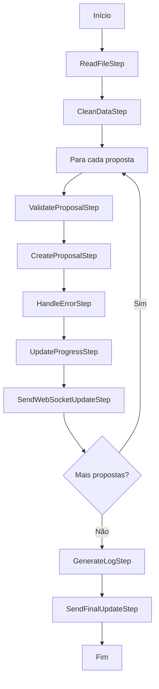

# Pipeline de Processamento de Lotes de Propostas

## Visão Geral

Esta pipeline foi criada para substituir o código monolítico da task `process_proposal_batch`, seguindo a abstração de pipeline definida em `core/base/pipeline.py`. A pipeline modulariza o processo de processamento de lotes de propostas em steps individuais e reutilizáveis, com suporte a WebSockets, relatórios de progresso e integração com Celery.

## Arquitetura

### Classe Base: `Step`
- **Localização**: `core/base/pipeline.py`
- **Responsabilidade**: Define a interface básica para um step de processamento
- **Métodos principais**:
  - `run(data)`: Executa a lógica do step
  - `__str__()`: Representação textual do step

### Classe Base: `Pipeline`
- **Localização**: `core/base/pipeline.py`
- **Responsabilidade**: Orquestra a execução sequencial de steps
- **Métodos principais**:
  - `run(data)`: Executa todos os steps em sequência
  - `add_step(step)`: Adiciona um step à pipeline
  - `remove_step(step)`: Remove um step da pipeline

## Steps Implementados

### 1. `ReadFileStep`
- **Função**: Lê o arquivo de propostas e extrai os dados
- **Input**: Contexto do batch
- **Output**: Contexto com dados extraídos e informações de contagem

### 2. `CleanDataStep`
- **Função**: Limpa valores NaN dos dados extraídos
- **Input**: Contexto com dados brutos
- **Output**: Contexto com dados limpos

### 3. `ValidateProposalStep`
- **Função**: Valida uma proposta individual usando `ProposalValidation`
- **Input**: Contexto da proposta individual
- **Output**: Contexto com resultado da validação

### 4. `CreateProposalStep`
- **Função**: Cria uma proposta válida no banco de dados
- **Input**: Contexto da proposta validada
- **Output**: Contexto com proposta criada (se válida)

### 5. `HandleErrorStep`
- **Função**: Registra propostas com erro em `ErroredProposal`
- **Input**: Contexto da proposta com erro
- **Output**: Contexto com erro registrado

### 6. `UpdateProgressStep`
- **Função**: Atualiza o progresso do processamento no batch
- **Input**: Contexto do batch
- **Output**: Contexto com progresso atualizado

### 7. `SendWebSocketUpdateStep`
- **Função**: Envia atualizações de progresso via WebSocket
- **Input**: Contexto do batch
- **Output**: Contexto após envio da atualização

### 8. `GenerateLogStep`
- **Função**: Gera arquivo Excel com propostas que tiveram erro
- **Input**: Contexto do batch
- **Output**: Contexto com log gerado

### 9. `SendFinalUpdateStep`
- **Função**: Envia atualização final de conclusão via WebSocket
- **Input**: Contexto do batch
- **Output**: Contexto após atualização final

## Pipelines Principais

### `ProposalProcessingPipeline` (Sub-Pipeline)

Pipeline para processar uma proposta individual:

```python
steps = [
    ValidateProposalStep(),
    CreateProposalStep(),
    HandleErrorStep()
]
```

### `ProposalBatchPipeline` (Pipeline Principal)

Pipeline principal para processar um lote completo:

1. **Steps Iniciais**:
   - `ReadFileStep`
   - `CleanDataStep`

2. **Para cada proposta**:
   - Executa `ProposalProcessingPipeline`
   - Executa steps de progresso

3. **Steps Finais**:
   - `GenerateLogStep`
   - `SendFinalUpdateStep`

### Fluxo de Execução Completo



### Saída da Pipeline

```python
{
    'success': bool,                    # True se executou sem erros
    'batch_id': str,                   # ID do batch processado
    'total_proposals': int,            # Total de propostas no arquivo
    'processed_proposals': int,        # Propostas processadas
    'success_count': int,              # Propostas criadas com sucesso
    'error_count': int,               # Propostas com erro
    'log_generated': bool,            # Se o log foi gerado
    'message': str                    # Mensagem de resumo
}
```

## Como Usar

### 1. Via Task do Celery (Recomendado)

```python
# Na view ou endpoint
from proposals.tasks import process_proposal_batch_with_pipeline

# Iniciar processamento com pipeline
task = process_proposal_batch_with_pipeline.delay(batch_id)
```

### 2. Via API REST

```bash
# Usar pipeline na requisição PUT
PUT /api/proposal-batches/{id}/
Content-Type: application/json

{
    "use_pipeline": true
}
```

### 3. Uso Programático

```python
from proposals.pipeline import ProposalBatchPipeline
from proposals.models import ProposalBatch

# Buscar batch
batch = ProposalBatch.objects.get(id=batch_id)

# Criar contexto
batch_context = {
    'batch': batch,
    'task_id': 'manual_execution'
}

# Executar pipeline
pipeline = ProposalBatchPipeline()
result = pipeline.run(batch_context)

# Verificar resultado
if result['success']:
    print(f"Processadas: {result['processed_proposals']}")
else:
    print(f"Erro: {result['error']}")
```

### 4. Sub-Pipeline Individual

```python
from proposals.pipeline import ProposalProcessingPipeline

# Processar proposta individual
proposal_context = {
    'proposal_data': {...},
    'batch': batch,
    'index': 0
}

pipeline = ProposalProcessingPipeline()
result = pipeline.run(proposal_context)
```

### 5. Steps Individuais

```python
from proposals.pipeline.proposal_batch_steps import ReadFileStep

# Usar step individual
read_step = ReadFileStep()
batch_context = {'batch': batch}
result = read_step.run(batch_context)
```

### 6. Pipeline Customizada

```python
from proposals.pipeline import ProposalBatchPipeline

# Criar pipeline customizada
pipeline = ProposalBatchPipeline()

# Adicionar step customizado
# pipeline.add_step(MeuStepCustomizado(), category='initial')

# Remover step se necessário
# pipeline.remove_step(algum_step)

# Executar
result = pipeline.run(batch_context)
```

## Benefícios da Arquitetura

### 1. **Modularidade**
- Cada step tem uma responsabilidade específica
- Fácil de testar individualmente
- Reutilização de steps em outras pipelines

### 2. **Manutenibilidade**
- Código mais limpo e organizado
- Fácil identificação de problemas
- Modificações isoladas por funcionalidade

### 3. **Extensibilidade**
- Adição de novos steps sem modificar código existente
- Criação de pipelines alternativas
- Customização fácil do fluxo

### 4. **Testabilidade**
- Testes unitários para cada step
- Testes de integração para a pipeline completa
- Mocking facilitado entre steps

### 5. **Rastreabilidade**
- Logs detalhados por step
- Estatísticas de execução
- Tratamento de erros granular

### 6. **Performance**
- Processamento otimizado por step
- Controle fino de memoria e recursos
- Possibilidade de paralelização futura

### 7. **Integração com WebSockets**
- Updates em tempo real
- Melhor experiência do usuário
- Monitoramento de progresso

## Recursos Avançados

### WebSocket Integration

A pipeline envia atualizações automáticas via WebSocket:

```javascript
// Frontend WebSocket connection
const ws = new WebSocket(`ws://localhost:8000/ws/proposal_batch/${batchId}/`);

ws.onmessage = function(event) {
    const data = JSON.parse(event.data);
    console.log(`Progresso: ${data.progress}%`);
    console.log(`Processadas: ${data.processed_proposals}/${data.total_proposals}`);
};
```

### Error Handling

```python
# A pipeline automaticamente:
# 1. Captura erros de propostas individuais
# 2. Continua processamento das demais
# 3. Gera log Excel com erros detalhados
# 4. Envia updates de erro via WebSocket
```

### Celery Integration

```python
# A task com pipeline suporta:
# - Updates de estado do Celery
# - Progresso reportado corretamente
# - Cancelamento graceful
# - Retry automático
```

## Exemplos de Uso

Consulte `proposals/pipeline/example_usage.py` para exemplos práticos de como usar a pipeline.

## Executando Exemplos

```bash
# No diretório do projeto
python manage.py shell

# No shell Django
from proposals.pipeline.example_usage import *
example_basic_usage()
example_individual_proposal_processing()
example_custom_pipeline()
example_individual_steps()
example_error_handling()
```

## Comparação: Antes vs Depois

### Antes (Task Monolítica)
```python
@shared_task(bind=True)
def process_proposal_batch(self, batch_id):
    # 200+ linhas de código misturado
    # Lógica de arquivo, validação, criação, websocket tudo junto
    # Difícil de testar e manter
    # Tratamento de erro complexo
    # Updates de progresso espalhados
```

### Depois (Pipeline Modular)
```python
@shared_task(bind=True)
def process_proposal_batch_with_pipeline(self, batch_id):
    batch_context = {'batch': batch, 'task_id': self.request.id}
    pipeline = ProposalBatchPipeline()
    result = pipeline.run(batch_context)
    # Lógica separada em steps específicos
    # Fácil de testar, manter e estender
    # Tratamento de erro robusto
    # Updates automáticos
```

## Monitoramento e Logs

### Logs por Step
```python
# Cada step pode gerar logs específicos
print(f"ReadFileStep: {total_rows} propostas encontradas")
print(f"ValidateProposalStep: Proposta {index} validada")
print(f"CreateProposalStep: Proposta criada com ID {proposal.id}")
```

### Métricas de Performance
```python
# A pipeline coleta automaticamente:
# - Tempo de execução por step
# - Memory usage
# - Taxa de sucesso/erro
# - Throughput de propostas
```

## Configuração

### Variáveis de Ambiente
```bash
# Controle de WebSocket
ENABLE_WEBSOCKET_UPDATES=true

# Intervalo de updates (em propostas processadas)
WEBSOCKET_UPDATE_INTERVAL=10

# Tamanho máximo do batch
MAX_BATCH_SIZE=10000
```

### Settings Django
```python
# settings.py
PROPOSAL_PIPELINE_CONFIG = {
    'enable_progress_updates': True,
    'websocket_updates': True,
    'generate_error_logs': True,
    'max_retries': 3
}
```

## Próximos Passos

1. **Testes Unitários**: Criar testes para cada step
2. **Testes de Integração**: Testar pipeline completa
3. **Performance**: Otimizar processamento em lote
4. **Paralelização**: Processar propostas em paralelo
5. **Monitoring**: Adicionar métricas detalhadas
6. **Caching**: Cache para validações repetitivas
7. **Retry Logic**: Retry automático para falhas temporárias
8. **Backup**: Backup automático antes do processamento

## Troubleshooting

### Problemas Comuns

1. **WebSocket não funciona**
   - Verificar configuração do channels
   - Verificar autenticação JWT
   - Verificar grupo de WebSocket

2. **Erro na validação**
   - Verificar layout configurado
   - Verificar mapeamento de campos
   - Verificar dados do arquivo

3. **Performance lenta**
   - Verificar tamanho do arquivo
   - Otimizar queries do banco
   - Considerar processamento em chunks 